# Detecção e diagnóstico de anomalias em sinais de vibração: CWRU

ECM514 Ciência de Dados, Instituto Mauá de Tecnologia. Desafio do 2º semestre, Grupo 4.

**Integrantes**

| Nome | RA |
|------|----|
| Felipe Kenzo Ohara Sakae | 22.00815-2 |
| Guilherme Martins Souza Paula | 22.00006-2 |
| Lucas Gozze Crapino | 22.00667-2 |
| Murillo Penha Strina | 22.00730-0 |
| Pedro Campos Dec | 22.00787-3 |
| Vinicius Garcia Imendes Dechechi | 22.01568-0 |

Todo o código está em `notebooks/CWRU_deteccao_diagnostico.ipynb` (executável no Colab). Tabelas e figuras citadas aqui estão em `results/`. As matrizes de confusão completas estão em `relatorio/anexo_matrizes_confusao.md`.

---

## Resumo

Usamos o conjunto de rolamentos da Case Western Reserve University (CWRU) para tratar duas tarefas separadas: detectar que algo mudou (detectores treinados só com sinais Normais) e diagnosticar o tipo de falha (Normal, pista interna IR, pista externa OR). Trabalhamos com o acelerômetro do lado do acionamento a 48 kHz, 28 gravações, três severidades de defeito (0,007", 0,014" e 0,021") e quatro cargas (0 a 3 HP). Cada gravação foi cortada em janelas de 0,5 s e descrita por 27 atributos: 7 de tempo, 10 energias de banda e 10 medidas do espectro do envelope nas frequências de falha BPFO e BPFI.

Três protocolos de avaliação foram comparados: split temporal dentro de cada gravação (P1), deixar uma carga de fora (P2) e deixar uma severidade de fora (P3). P1, P2 e um split aleatório de janelas dão 100% de acurácia para todos os classificadores, e o RMS da janela sozinho já separa Normal de falha sem sobreposição. Esses protocolos não distinguem uma técnica boa de uma ruim. O P3 distingue: o Random Forest com tempo e envelope cai para 62,2% de acurácia, com recall de OR de 32,4%, e a falha OR de 0,014" nunca é reconhecida, porque a assinatura dela no envelope é praticamente inexistente. A detecção só com Normal separa as classes (AUROC 1,0), mas o FPR depende da calibração do limiar: em P2 vai de 11% a 83% conforme o detector e a calibração.

---

## 1. Introdução

Rolamentos estão entre os componentes que mais falham em máquinas rotativas, e uma falha não detectada costuma virar parada não programada. A vibração é a medida mais usada para acompanhar a condição desses componentes: um defeito localizado gera um impacto cada vez que um elemento rolante passa por ele, e a taxa desses impactos depende da geometria do rolamento e da rotação do eixo (Randall e Antoni, 2011).

O enunciado do desafio separa dois problemas que costumam ser misturados. **Detecção** pergunta se a máquina mudou em relação ao normal. Em uma planta real só existe histórico do estado normal antes da primeira falha, então um detector precisa ser treinado só com Normal. **Diagnóstico** pergunta qual é o defeito, e aí são necessários exemplos rotulados de cada tipo.

Nosso objetivo foi aplicar e comparar técnicas para as duas tarefas em um dataset público documentado (CWRU), com 3 classes, e responder com evidência a uma pergunta mais importante que o ranking de técnicas: **os números que obtemos dizem alguma coisa sobre o defeito, ou só sobre o jeito como os dados foram divididos?** Boa parte do relatório trata disso.

O texto segue a ordem: dataset (seção 2), fundamentação das técnicas (3), metodologia (4), resultados (5), discussão crítica (6), conclusão (7), referências (8) e declaração de uso de IA (9).

---

## 2. Descrição do dataset

### 2.1 Origem e montagem

Os dados vêm do Bearing Data Center da Case Western Reserve University (engineering.case.edu/bearingdatacenter). Os 28 arquivos .mat usados foram baixados do site oficial (engineering.case.edu/sites/default/files/NUMERO.mat) em 04/10/2026 e seus SHA-256 coincidem com os dos arquivos do espelho público (github.com/s-whynot/CWRU-dataset) que o notebook baixa e verifica sozinho. Uma primeira tentativa de baixar o arquivo 239 veio truncada (6.020.315 de 7.826.336 bytes, com os bytes iniciais idênticos); um segundo download veio completo e bateu.

A bancada tem um motor de 2 HP, um transdutor de torque com encoder e um dinamômetro. O rolamento testado é um SKF 6205-2RS no lado do acionamento (drive end, DE). Os defeitos são furos feitos por eletroerosão, com diâmetros de 0,007", 0,014" e 0,021", na pista interna (IR) ou na pista externa (OR, na posição de 6 h). O ensaio foi repetido com quatro cargas, de 0 a 3 HP, com rotação nominal de 1797 a 1730 rpm (nas gravações usadas, entre 1725 e 1797 rpm). A "carga" do CWRU é torque no eixo: reduz a rotação em cerca de 4% e não acrescenta carga radial sobre o rolamento. Isso importa para a interpretação do protocolo P2, discutida na seção 6.

A geometria do rolamento (9 esferas, diâmetro da esfera d = 0,3126" e diâmetro primitivo D = 1,537") dá as frequências de falha em múltiplos da frequência de rotação fr: **BPFO = 3,5848 fr** e **BPFI = 5,4152 fr**. Usamos a rotação gravada em cada arquivo; nos Normais que não trazem rotação gravada (98 e 99), usamos a nominal da carga.

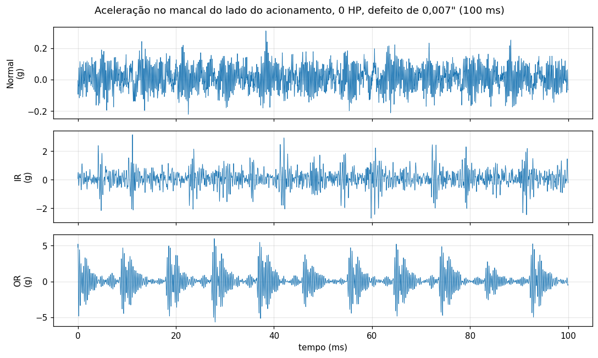

*Figura 1. 100 ms de aceleração a 0 HP com defeito de 0,007". No OR os impactos aparecem como pulsos regulares, bem separados; no IR eles variam de amplitude porque o defeito gira com o eixo; o Normal é só ruído de banda larga. Observe também as escalas: o OR chega a 5 g e o Normal fica abaixo de 0,3 g.*

### 2.2 Taxa de amostragem

Usamos 48 kHz para todas as classes. O site do CWRU não informa a taxa das gravações Normais e fontes diferentes se contradizem. Confirmamos empiricamente: o pico de 1x da rotação cai em 28,75 a 30 Hz quando o sinal é lido a 48 kHz e em 35,5 a 37 Hz se lido a 12 kHz; só o primeiro intervalo é compatível com 1725 a 1797 rpm (28,75 a 29,95 Hz) (`results/inventario_arquivos.csv`). Se as classes tivessem taxas diferentes, um detector separaria Normal de falha pela taxa de amostragem e não pelo defeito. Os arquivos de falha em 48 kHz existem no CWRU para o DE, então não foi preciso decimar nada.

### 2.3 Amostras por classe

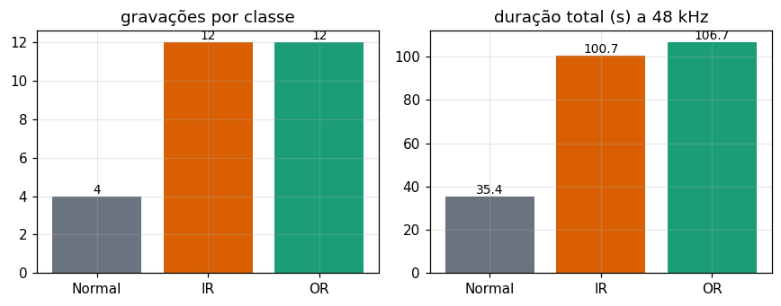

*Figura 2. Quantidade de gravações e duração total por classe. A classe Normal tem só 4 gravações e cerca de 35 s, um terço do tempo de cada classe de falha. A de 0 HP (arquivo 97) tem apenas 5,08 s.*

| Classe | Gravações | Amostras | Duração |
|---|---|---|---|
| Normal | 4 (uma por carga) | 1.698.547 | 35,4 s |
| IR | 12 (3 severidades x 4 cargas) | 4.830.126 | 100,6 s |
| OR (6 h) | 12 (3 severidades x 4 cargas) | 5.122.638 | 106,7 s |

Janelas de 0,5 s (24.000 amostras) com 50% de sobreposição no treino e sem sobreposição na avaliação resultam nas contagens por protocolo de `results/contagem_janelas.csv`. Por exemplo, no P1 há 94 janelas de treino e 17 de teste por classe; no P3 o teste tem 17 janelas Normais, 70/57/70 de IR e 70/70/70 de OR (por severidade retirada).

### 2.4 Armadilhas encontradas nos arquivos

- O arquivo `99.mat` contém duas variáveis `DE_time`, a X099 e uma cópia da X098. Pegar "a primeira variável DE" duplicaria o registro 98 e perderia o 99. Cada variável é escolhida pelo prefixo esperado.
- `174_0.mat` guarda a variável X173 (1,3 s), `175_1.mat` tem uma X217 extra sem RPM e `217_3.mat` repete a X215. O mapeamento arquivo, variável e rotação está em `scripts/baixar_dados.py`.
- O pacote do Kaggle indicado pelo professor foi auditado (`scripts/auditoria_kaggle.py`): tem 36 arquivos de falha a 12 kHz e 4 Normais a 48 kHz misturados, o Normal_2 é cópia do Normal_1 (a gravação real do arquivo 99 não está lá) e há inconsistência de carga e RPM em B007, B021, IR021 e OR0146. Por isso o projeto não usa esse pacote como fonte.

### 2.5 Como os sinais se diferenciam

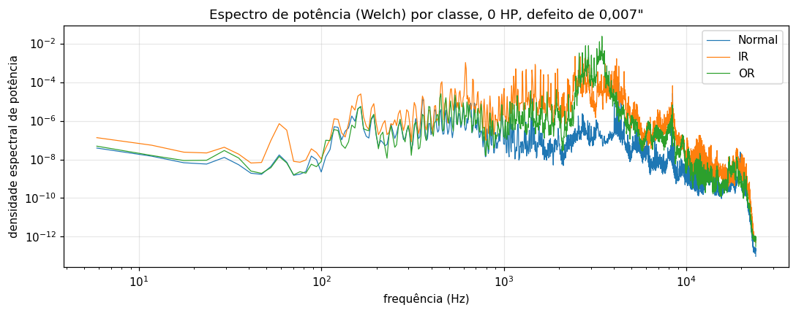

*Figura 3. Densidade espectral de potência (Welch) a 0 HP, defeito de 0,007". As duas falhas elevam a energia entre 2 e 8 kHz em ordens de grandeza em relação ao Normal. Esse patamar de energia é o que um detector de amplitude usa, e é a razão do "atalho" discutido nas seções 5 e 6.*

---

## 3. Fundamentação das técnicas

### 3.1 Assinatura de falha e análise de envelope

Cada passagem de um elemento rolante pelo defeito produz um impacto curto que excita ressonâncias da estrutura. O sinal medido é uma série de respostas impulsivas repetidas na frequência de falha (McFadden e Smith, 1984). Essa frequência fica abaixo de algumas centenas de Hz, onde o espectro do sinal bruto é dominado por componentes do eixo e da rede elétrica. A informação do defeito está na *modulação* da banda de ressonância, e é isso que a **análise de envelope** extrai: filtra-se o sinal passa-banda em torno de uma ressonância, calcula-se o envelope pela transformada de Hilbert e olha-se o espectro desse envelope. Um defeito na pista externa produz BPFO e harmônicos; na pista interna, BPFI e harmônicos com bandas laterais espaçadas de fr, porque o defeito entra e sai da zona de carga a cada volta (Randall e Antoni, 2011; Smith e Randall, 2015).

A escolha da banda de demodulação é o ponto crítico. O kurtograma escolhe a banda de maior curtose espectral (Antoni, 2006; Antoni, 2007). Neste trabalho a banda é escolhida por uma varredura simples, só com janelas de falha do conjunto de treino de cada protocolo, maximizando a SNR média em BPFO/BPFI.

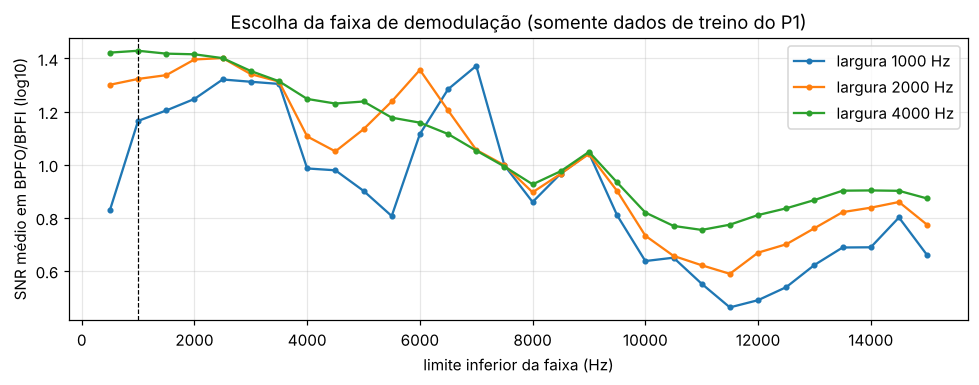

*Figura 4. SNR média do envelope nas frequências BPFO/BPFI em função do limite inferior da banda, para três larguras (dados de treino do P1). A linha tracejada marca a banda escolhida (1000 a 5000 Hz).*

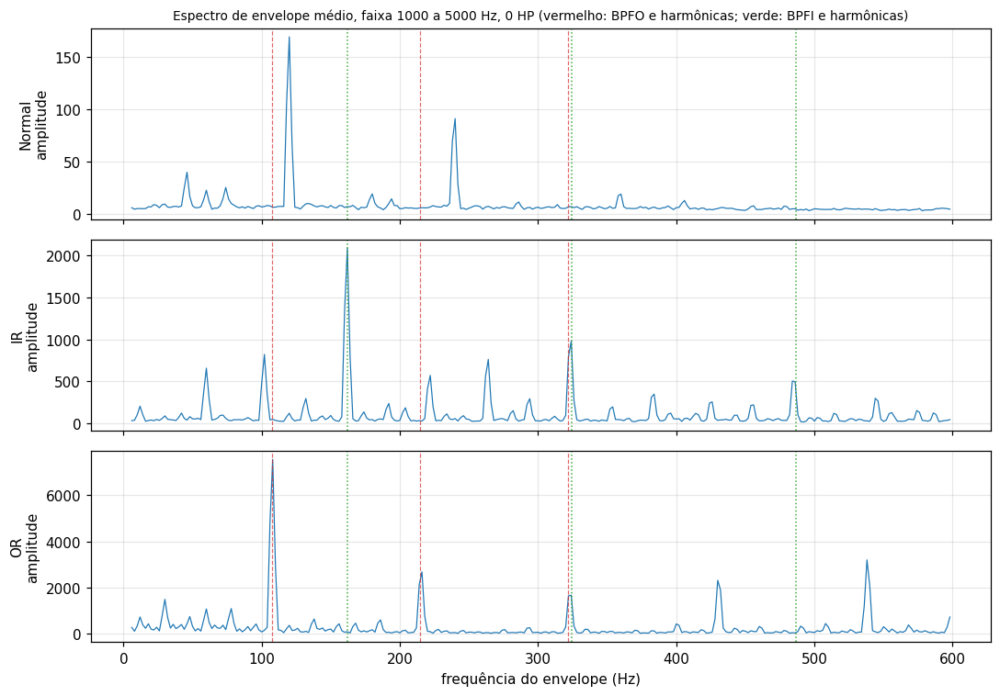

*Figura 5. Espectro de envelope médio na banda de 1000 a 5000 Hz, 0 HP, 0,007". No OR o pico dominante cai exatamente em BPFO (linhas vermelhas); no IR, em BPFI (linhas verdes), com bandas laterais. O Normal só tem picos em 120 e 240 Hz, múltiplos da rede elétrica (60 Hz), que não pertencem a nenhuma família de defeito.*

### 3.2 Atributos

Do domínio do tempo (7): RMS, pico, fator de crista, curtose (Pearson), assimetria, fator de forma e fator de impulso, que são os indicadores clássicos de monitoramento de condição (Randall, 2011; Neupane e Seok, 2020). Energia de banda (10): log da energia do espectro em dez faixas. Envelope (10): razão, em log10, entre o pico do espectro do envelope perto de cada frequência característica (BPFO, 2xBPFO, 3xBPFO, BPFI, 2xBPFI, 3xBPFI, 1x, 2x e bandas laterais de BPFI) e a mediana da vizinhança, com tolerância de alguns bins por causa do escorregamento.

### 3.3 Detecção só com Normal

Um detector produz um escore maior quanto mais a janela se afasta do normal, e um limiar define o alarme (Chandola et al., 2009).

- **Isolation Forest** (Liu et al., 2008; Liu et al., 2012): isola cada ponto com cortes aleatórios; pontos anômalos são isolados com poucos cortes. Usamos 300 árvores.
- **One-Class SVM** (Schölkopf et al., 2001; Tax e Duin, 2004): ajusta uma fronteira fechada em torno dos dados normais no espaço do kernel RBF, com nu = 0,05.
- **Distância de Mahalanobis** (De Maesschalck et al., 2000) com covariância Ledoit-Wolf (Ledoit e Wolf, 2004): mede a distância à média normal, considerando a correlação entre atributos. A estimativa regularizada é necessária porque há poucas janelas Normais.

Os detectores usam os 17 atributos de tempo e energia de banda (sem o envelope, que depende de saber a falha esperada), padronizados com média e desvio só dos Normais de treino.

### 3.4 Classificação do tipo de falha

- **Random Forest** (Breiman, 2001; Hastie et al., 2009): conjunto de 300 árvores com bootstrap e subconjunto aleatório de atributos em cada nó.
- **SVM com kernel RBF** (Cortes e Vapnik, 1995; Hastie et al., 2009), C = 10.
- **kNN** (Cover e Hart, 1967; Hastie et al., 2009), k = 5.
- **Regressão logística** (Hosmer et al., 2013; Hastie et al., 2009).
- **Pipeline de duas etapas**: detector Isolation Forest decide se há falha e, se houver, um Random Forest decide o tipo. Variantes com o classificador de tipo só com atributos de envelope.

Todos pela implementação do scikit-learn (Pedregosa et al., 2011).

### 3.5 Métricas e incerteza

Reportamos TPR (fração das janelas de falha que disparam alarme), FPR (fração das janelas Normais que disparam), AUROC para detectores (Fawcett, 2006), recall por classe e matrizes de confusão. Os intervalos de 95% são de Wilson (Wilson, 1927; Agresti e Coull, 1998). Importante: eles tratam cada janela como uma observação independente, o que não é verdade (janelas do mesmo arquivo são correlacionadas), então os intervalos são otimistas. Voltamos a isso na seção 6.

---

## 4. Metodologia

### 4.1 Janelas e atributos

Cada gravação é cortada em janelas de 0,5 s a 48 kHz (24.000 amostras), com a média removida. No treino o passo é 12.000 amostras (50% de sobreposição); na avaliação é 24.000 (sem sobreposição). Entre o trecho de treino e o de teste do mesmo sinal existe uma guarda de 12.000 amostras, para que nenhuma janela de teste compartilhe amostras com uma de treino. A semente é 42.

### 4.2 Protocolos de divisão treino/teste

| Protocolo | O que fica de fora do treino | Pergunta que responde |
|---|---|---|
| Ingênuo (aleatório) | nada, janelas sorteadas | só serve para mostrar o teto (vaza janelas vizinhas) |
| P1, split temporal | os últimos 30% de cada gravação | o modelo reconhece o mesmo ensaio mais adiante no tempo? |
| P2, leave-one-load-out | uma carga inteira (0, 1, 2 ou 3 HP), com defeito de 0,007" | generaliza para outra carga? |
| P3, leave-one-severity-out | uma severidade inteira (0,007", 0,014" ou 0,021") de IR e OR | generaliza para um defeito de outro tamanho? |

No P3 a classe Normal usa o mesmo split temporal do P1, porque ela não tem severidade. Em todos os protocolos, padronização, banda do envelope, limiares e pesos do classificador são ajustados só com o treino.

### 4.3 Calibração do limiar dos detectores

O limiar é o percentil 95 dos escores de janelas Normais *fora da amostra de treino*, obtidos de duas maneiras. **Limiar temporal**: validação cruzada em blocos de tempo (K = 5, descartando janelas vizinhas). **Limiar por carga**: leave-one-load-out dentro dos Normais de treino, que simula "uma carga que o detector nunca viu". Reportamos as duas, porque a carga muda a distribuição do Normal e o limiar temporal subestima isso.

### 4.4 Conjuntos de atributos e ablação

Os classificadores foram avaliados com quatro conjuntos de atributos (tempo, espectro por faixas, envelope e tempo + envelope), com o Random Forest, para separar quanto do desempenho vem da amplitude e quanto da assinatura de falha.

### 4.5 Reprodutibilidade

O notebook baixa e verifica os dados (tamanho e SHA-256), fixa a semente e grava todas as tabelas e figuras em `results/`. A execução completa leva cerca de 6 a 7 minutos em CPU. As figuras 11 a 15 são geradas na seção 10b do notebook; `scripts/gerar_figuras_relatorio.py` produz as mesmas figuras fora do notebook.

---

## 5. Resultados

### 5.1 A energia total já separa as classes

Antes de qualquer modelo, a figura 6 mostra o RMS de cada janela de 0,5 s de todas as 28 gravações.

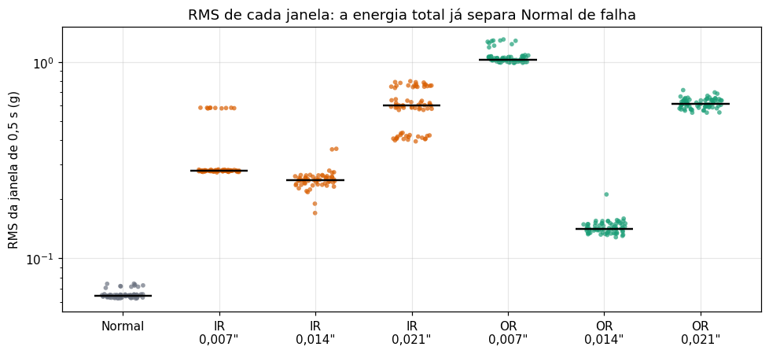

*Figura 6. RMS de cada janela, por classe e severidade (traço preto = mediana). As janelas Normais vão de 0,063 a 0,074 g; a janela de falha de menor RMS tem 0,128 g, mais de 1,7 vez o maior valor Normal. Qualquer limiar entre 0,074 e 0,128 separa as duas condições sem erro, em qualquer carga.*

Esse gráfico explica por que P1 e P2 saturam, e traz um segundo fato importante: o RMS **não cresce com a severidade**. No OR a mediana é 1,03 g com 0,007", 0,14 g com 0,014" e 0,61 g com 0,021". O defeito de 0,014" vibra muito menos que os outros dois. Isso vai pesar no P3.

### 5.2 Detecção (treino só com Normal)

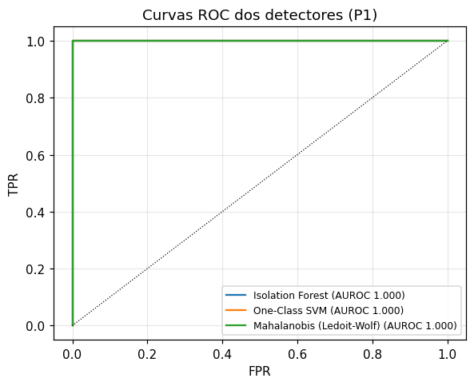

*Figura 7. Curvas ROC dos três detectores no P1. Todas ficam coladas no canto superior esquerdo (AUROC 1,000). A curva diz que os escores ordenam bem, mas não diz nada sobre o FPR no limiar que adotamos.*

O AUROC é 1,0 nos três protocolos. O que varia é o FPR no limiar adotado, e ele depende de como o limiar foi calibrado:

| Protocolo | Detector | TPR | FPR, limiar temporal | FPR, limiar por carga |
|---|---|---|---|---|
| P1 | os três | 100% [89,8; 100] | 0% [0; 18,4] | 0% [0; 18,4] |
| P2 | Isolation Forest | 100% [97,3; 100] | 17,1% [10,1; 27,6] | 11,4% [5,9; 21,0] |
| P2 | One-Class SVM | 100% | 77,1% [66,0; 85,4] | 60,0% [48,3; 70,7] |
| P2 | Mahalanobis (Ledoit-Wolf) | 100% | 82,9% [72,4; 89,9] | 14,3% [7,9; 24,3] |
| P3 | os três | 100% [99,1; 100] | 0% [0; 18,4] | 0% [0; 18,4] |

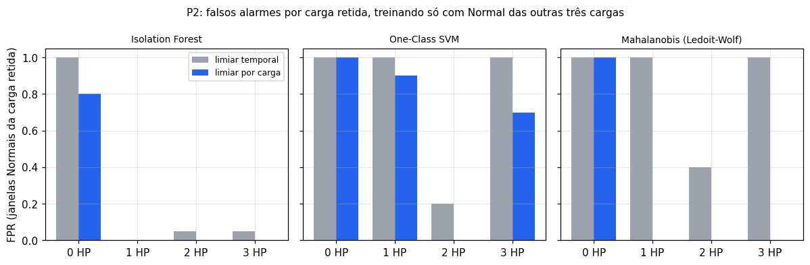

*Figura 8. P2: FPR por carga retirada, com os dois limiares. Com o limiar por carga, o Mahalanobis zera o FPR em 1, 2 e 3 HP. Sobra o fold de 0 HP, onde o único Normal tem 5 s e um desvio-padrão um pouco maior (0,073 contra cerca de 0,065 nas outras cargas): é extrapolação real, não erro de calibração.*

Dois pontos de leitura. O One-Class SVM, com fronteira mais justa, trata como anomalia quase qualquer Normal de uma carga que não viu. E o desempenho de detecção só é bom quando a calibração considera a variabilidade entre cargas, o que um limiar calculado em janelas vizinhas no tempo não faz.

### 5.3 Diagnóstico nos protocolos P1 e P2

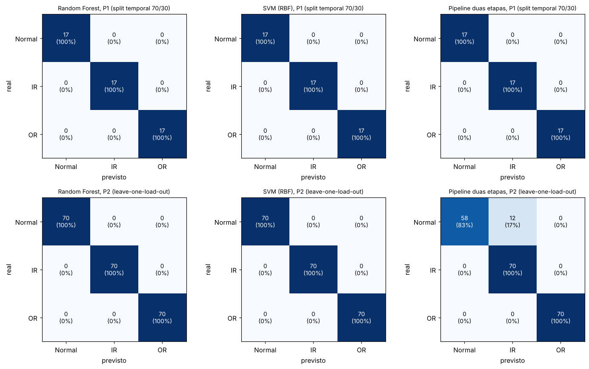

*Figura 9. Matrizes de confusão (Random Forest, SVM e pipeline de duas etapas) em P1 e P2. Todas diagonais perfeitas, exceto o pipeline em P2: o Isolation Forest com limiar temporal marca 12 de 70 janelas Normais como falha (FPR 17,1%) e elas viram "IR".*

Random Forest, SVM, kNN e regressão logística dão 100% em P1 e P2 com tempo + envelope. O pipeline de duas etapas herda o FPR do detector, então perde acurácia onde o classificador direto não perde.

### 5.4 Quatro protocolos, o mesmo modelo

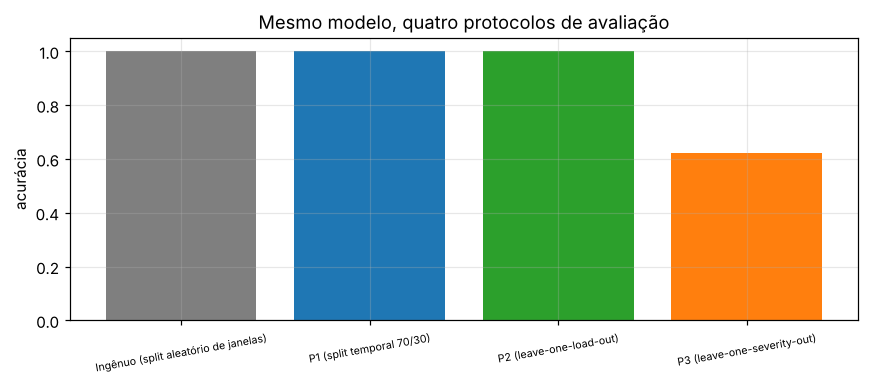

*Figura 10. Acurácia do mesmo Random Forest (tempo + envelope) sob os quatro protocolos. O ingênuo, o P1 e o P2 dão 1,0. Só o P3 mostra que há algo a ser resolvido: 0,622.*

### 5.5 Diagnóstico com uma severidade retirada do treino (P3)

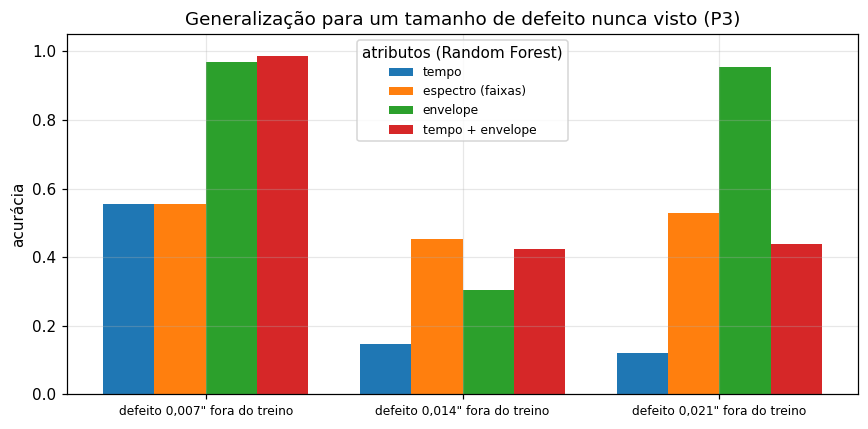

*Figura 11. Acurácia do Random Forest em P3 para cada severidade retida e cada conjunto de atributos. Atributos de tempo falham quando a amplitude muda (0,15 e 0,12 de acurácia em 0,014" e 0,021"). Só com envelope, 0,007" e 0,021" vão bem (0,968 e 0,955), mas 0,014" não passa de 0,306.*

| Severidade fora do treino | Tempo | Espectro | Envelope | Tempo + envelope |
|---|---|---|---|---|
| 0,007" | 0,554 | 0,554 | 0,968 | 0,987 |
| 0,014" | 0,146 | 0,451 | 0,306 | 0,424 |
| 0,021" | 0,121 | 0,529 | 0,955 | 0,439 |

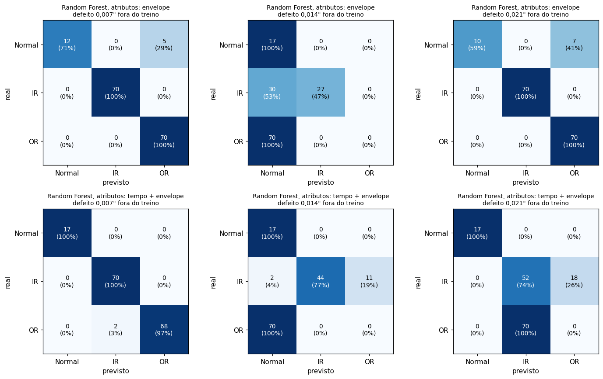

*Figura 12. Matrizes de confusão do Random Forest em P3, só com envelope (linha de cima) e com tempo + envelope (linha de baixo). Com tempo + envelope, as 70 janelas OR de 0,014" viram "Normal" e as 70 de 0,021" viram "IR".*

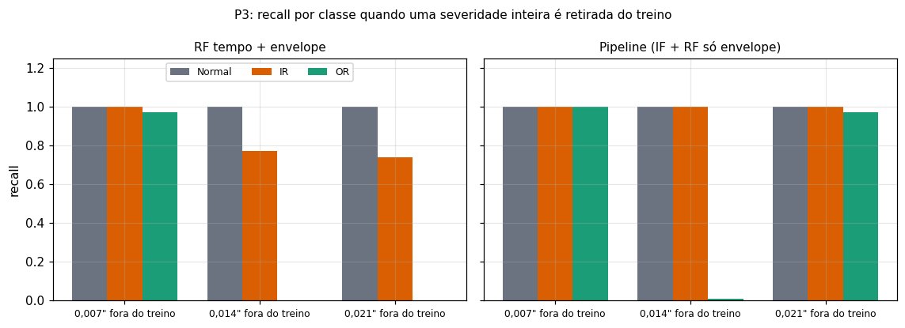

*Figura 13. Recall por classe em P3. À esquerda, o Random Forest com tempo + envelope: OR tem recall zero em 0,014" e 0,021". À direita, o pipeline com o tipo decidido só por atributos de envelope: IR é sempre reconhecida e OR só falha em 0,014".*

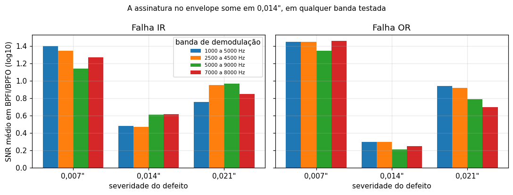

*Figura 14. SNR do envelope nas frequências BPFI/BPFO por severidade e banda. Em 0,014" ela cai para 0,2 a 0,6, contra 1,1 a 1,5 em 0,007". Nenhuma das quatro bandas testadas recupera o sinal, então o problema não é a escolha da banda.*

### 5.6 Tabela resumo

Formato pedido no enunciado, com os principais resultados. A tabela completa (todos os protocolos, técnicas e calibrações) está em `results/tabela_resumo.md`.

| Dataset | Técnica | Tipo de falha identificada | TPR (IC 95%) | FPR (IC 95%) | Acurácia por classe |
|---|---|---|---|---|---|
| CWRU | P1, qualquer técnica | IR, OR | 100% [89,8; 100] | 0% [0; 18,4] | Normal 100, IR 100, OR 100 |
| CWRU | P2, Random Forest (tempo + envelope) | IR, OR | 100% [97,3; 100] | 0% [0; 5,2] | Normal 100, IR 100, OR 100 |
| CWRU | P2, Isolation Forest (limiar temporal) | não se aplica | 100% [97,3; 100] | 17,1% [10,1; 27,6] | não se aplica (AUROC 1,000) |
| CWRU | P2, Isolation Forest (limiar por carga) | não se aplica | 100% [97,3; 100] | 11,4% [5,9; 21,0] | não se aplica (AUROC 1,000) |
| CWRU | P2, One-Class SVM (temporal / por carga) | não se aplica | 100% | 77,1% / 60,0% | não se aplica |
| CWRU | P2, Mahalanobis (temporal / por carga) | não se aplica | 100% | 82,9% / 14,3% | não se aplica |
| CWRU | P3, detectores (qualquer) | não se aplica | 100% [99,1; 100] | 0% [0; 18,4] | não se aplica (AUROC 1,000) |
| CWRU | P3, Random Forest (tempo + envelope) | IR, OR | 82,3% [78,3; 85,7] | 0% [0; 7,0] | Normal 100, IR 84,3, OR 32,4 |
| CWRU | P3, SVM RBF | IR | 82,3% | 2,0% | Normal 98,0, IR 57,4, OR 0,0 |
| CWRU | P3, kNN (k = 5) | IR, OR | 82,3% | 9,8% | Normal 90,2, IR 58,4, OR 33,3 |
| CWRU | P3, Regressão logística | IR, OR | 82,3% | 3,9% | Normal 96,1, IR 71,1, OR 33,3 |
| CWRU | P3, pipeline IF + RF (tempo + envelope) | IR, OR | 100% [99,1; 100] | 0% [0; 7,0] | Normal 100, IR 88,3, OR 32,4 |
| CWRU | P3, pipeline IF + RF (tipo só por envelope) | IR, OR | 100% | 0% | Normal 100, IR 100, OR 66,2 |
| CWRU | P3, Random Forest (só envelope) | IR, OR | 75,4% [71,0; 79,4] | 23,5% [14,0; 36,8] | Normal 76,5, IR 84,8, OR 66,7 |

Nas linhas de classificação, TPR e FPR tratam "falha" como qualquer classe diferente de Normal. Os intervalos são de Wilson sobre janelas.

---

## 6. Discussão crítica

### 6.1 O que funcionou

**O protocolo P3 expôs o que P1 e P2 escondiam.** Com três protocolos sobre o mesmo modelo, a diferença entre 1,0 e 0,62 mostra que a acurácia depende mais de como se divide do que de qual técnica se usa. Sem o P3 teríamos reportado 100% e nenhuma conclusão útil.

**Atributos de envelope generalizam melhor que amplitude.** Em P3, só com envelope, 0,007" e 0,021" chegam a 0,968 e 0,955, contra 0,554 e 0,121 só com tempo. A frequência do pico de envelope não muda com a amplitude do defeito; o RMS muda.

**O pipeline com tipo decidido só por envelope foi o melhor.** Detecção sem falsos positivos em P3 e recall de IR 100% e OR 66,2%, contra OR 32,4% do melhor modelo com amplitude.

**Escolher a banda só com treino e calibrar o limiar por carga** reduziu o FPR de forma mensurável (Mahalanobis em P2: de 82,9% para 14,3%).

### 6.2 O que não funcionou

**Os 100% de P1 e P2 não mostram capacidade de diagnóstico.** A figura 6 mostra o porquê: nenhuma janela de falha tem RMS dentro da faixa Normal. Qualquer detector ou classificador que use amplitude acerta tudo. Isso não é vazamento (guarda entre treino e teste, carga ou severidade retida), é um atalho real dos dados: gravações Normais vibram menos que todas as de falha.

**A falha OR de 0,014" não é reconhecida por nenhum modelo.** Duas causas independentes: (1) a amplitude dela (RMS mediano 0,14 g) fica entre a do Normal e a das outras severidades, então modelos de tempo a confundem; (2) a assinatura em BPFO é fraca (SNR de 0,2 a 0,3, contra 1,4 em 0,007") e há um pico forte em cerca de 4 vezes a rotação no envelope que o Normal também tem, então o envelope dela se parece com o do Normal. Tentamos bandas fixas e critério maximin (apêndice A do notebook), que não resolveram, e atributos invariantes de escala (apêndice B), que ajudaram só em parte. A literatura reporta que parte das gravações do CWRU não mostra a assinatura do defeito declarado (Smith e Randall, 2015), o que é consistente com o que vemos.

**Os detectores de Normal não se transferem entre cargas sem cuidado.** Mesmo com AUROC 1,0, o FPR em P2 chega a 83% com o limiar temporal. O 0 HP segue com FPR alto porque só há 5 s de Normal nessa carga e, ao tirá-la do treino, o detector extrapola.

**Classificadores que usam amplitude erram de formas sistemáticas.** Em P3 o SVM tem recall de OR de 0% e o kNN e a regressão logística de 33%; o Random Forest com tempo + envelope manda as 70 janelas OR de 0,021" para IR.

### 6.3 Análise dos erros

No P3 com Random Forest (tempo + envelope), a matriz de confusão agregada das três rodadas (`relatorio/anexo_matrizes_confusao.md`) é: Normal 51 de 51 certos; IR 166 de 197 certos (2 viram Normal e 29 viram OR); OR 68 de 210 certos (70 viram Normal, 72 viram IR). Os erros de OR concentram-se em duas rodadas: as 70 janelas de 0,014" (tomadas por Normal) e as 70 de 0,021" (tomadas por IR). Em ambos os casos o modelo está seguindo a amplitude: a OR de 0,014" vibra pouco, e a de 0,021" tem RMS de 0,61 g, semelhante ao da IR de 0,021", que ele viu no treino.

### 6.4 Limitações

- **Poucas gravações, janelas correlacionadas.** São 28 gravações. Os intervalos de Wilson tratam janelas como independentes, então são estreitos demais; o número efetivo de observações está mais perto do número de gravações. Um bootstrap por gravação seria mais honesto.
- **Poucos dados Normais.** São 4 gravações, a de 0 HP com 5 s, e o FPR em P3 vem de 17 janelas (IC até 18,4%).
- **A carga do CWRU é torque**, que muda pouco o sinal (cerca de 4% na rotação). P2 é um teste brando, e cada combinação de classe e severidade foi ensaiada em uma montagem, então um modelo pode "reconhecer a montagem".
- **Defeitos artificiais** (furos por eletroerosão), uma única bancada e um único tipo de rolamento. Nada aqui garante generalização para outra máquina ou para um defeito real incipiente.
- **Hiperparâmetros fixos** (Random Forest com 300 árvores, SVM com C = 10, kNN com k = 5), sem busca em grade. Rodamos uma única semente.
- **Escolha de decisões olhando resultados.** A análise de bandas fixas e de atributos invariantes (apêndices) foi feita depois de ver o resultado em P3 e deve ser lida como exploratória.
- **Importância por permutação em P2 não informa.** Com 100% de acurácia e atributos redundantes (RMS, pico e energias de banda carregam a mesma informação), embaralhar um atributo isolado não derruba o F1, então todas as barras ficam em zero. Por isso a figura `08_importancia.png` não é usada neste relatório, e a evidência do atalho é a figura 6.

### 6.5 O que faríamos com mais tempo ou dados

- Bootstrap por gravação e teste binomial por gravação, para intervalos de confiança honestos.
- Várias sementes e busca em grade com validação cruzada agrupada por gravação.
- Pré-branqueamento cepstral ou separação de componentes discretos antes do envelope (Randall e Antoni, 2011; Smith e Randall, 2015), para tentar recuperar a assinatura em 0,014".
- Validação física gravação a gravação: verificar se o pico do envelope cai em BPFO/BPFI em cada arquivo e comparar com o diagnóstico de Smith e Randall (2015).
- Um detector com mais dados Normais, de outras montagens ou outro dataset, para estimar a variabilidade normal real.

---

## 7. Conclusão

Os resultados mostram que, no CWRU, acurácia alta pode ser obtida só pela amplitude do sinal e, por isso, informa pouco sobre capacidade de diagnóstico. Com split temporal, carga retida ou split aleatório, todas as técnicas dão 100%, e o RMS sozinho separa Normal de falha sem sobreposição. O protocolo que discrimina é deixar uma severidade de defeito de fora: nele, o Random Forest com tempo + envelope cai para 62,2% de acurácia, com recall de OR de 32,4%.

Na detecção, treinar só com Normal separa bem as condições (AUROC 1,0), mas o desempenho prático depende da calibração do limiar: o FPR em P2 vai de 11% a 83%, e a calibração por carga o reduz, mas não o elimina. Na classificação, atributos de envelope generalizam melhor que atributos de amplitude, e o melhor resultado em P3 foi o pipeline em que um detector decide se há falha e um classificador só com envelope decide o tipo (IR 100%, OR 66,2%, FPR 0%). A falha OR de 0,014" permanece sem solução, porque a assinatura dela no envelope é quase inexistente em qualquer banda testada.

A conclusão principal é metodológica: o resultado de um protocolo só vale o quanto o protocolo se parece com a situação em que o modelo vai operar, e um número alto em P1 ou P2 não prova diagnóstico.

---

## 8. Referências

AGRESTI, A.; COULL, B. A. Approximate is better than "exact" for interval estimation of binomial proportions. *The American Statistician*, v. 52, n. 2, p. 119-126, 1998. DOI: 10.2307/2685469.

ANTONI, J. The spectral kurtosis: a useful tool for characterising non-stationary signals. *Mechanical Systems and Signal Processing*, v. 20, n. 2, p. 282-307, 2006. DOI: 10.1016/j.ymssp.2004.09.001.

ANTONI, J. Fast computation of the kurtogram for the detection of transient faults. *Mechanical Systems and Signal Processing*, v. 21, n. 1, p. 108-124, 2007. DOI: 10.1016/j.ymssp.2005.12.002.

BERGMEIR, C.; BENÍTEZ, J. M. On the use of cross-validation for time series predictor evaluation. *Information Sciences*, v. 191, p. 192-213, 2012. DOI: 10.1016/j.ins.2011.12.028.

BREIMAN, L. Random forests. *Machine Learning*, v. 45, n. 1, p. 5-32, 2001. DOI: 10.1023/A:1010933404324.

CASE WESTERN RESERVE UNIVERSITY. *Bearing Data Center: Seeded Fault Test Data*. Disponível em: engineering.case.edu/bearingdatacenter. Acesso em: 04 out. 2026.

CHANDOLA, V.; BANERJEE, A.; KUMAR, V. Anomaly detection: a survey. *ACM Computing Surveys*, v. 41, n. 3, art. 15, p. 1-58, 2009. DOI: 10.1145/1541880.1541882.

CORTES, C.; VAPNIK, V. Support-vector networks. *Machine Learning*, v. 20, n. 3, p. 273-297, 1995. DOI: 10.1023/A:1022627411411.

COVER, T. M.; HART, P. E. Nearest neighbor pattern classification. *IEEE Transactions on Information Theory*, v. 13, n. 1, p. 21-27, 1967. DOI: 10.1109/TIT.1967.1053964.

DE MAESSCHALCK, R.; JOUAN-RIMBAUD, D.; MASSART, D. L. The Mahalanobis distance. *Chemometrics and Intelligent Laboratory Systems*, v. 50, n. 1, p. 1-18, 2000. DOI: 10.1016/S0169-7439(99)00047-7.

FAWCETT, T. An introduction to ROC analysis. *Pattern Recognition Letters*, v. 27, n. 8, p. 861-874, 2006. DOI: 10.1016/j.patrec.2005.10.010.

HASTIE, T.; TIBSHIRANI, R.; FRIEDMAN, J. *The Elements of Statistical Learning*. 2. ed. New York: Springer, 2009. DOI: 10.1007/978-0-387-84858-7.

HOSMER, D. W.; LEMESHOW, S.; STURDIVANT, R. X. *Applied Logistic Regression*. 3. ed. Hoboken: Wiley, 2013. DOI: 10.1002/9781118548387.

LEDOIT, O.; WOLF, M. A well-conditioned estimator for large-dimensional covariance matrices. *Journal of Multivariate Analysis*, v. 88, n. 2, p. 365-411, 2004. DOI: 10.1016/S0047-259X(03)00096-4.

LIU, F. T.; TING, K. M.; ZHOU, Z.-H. Isolation forest. In: IEEE INTERNATIONAL CONFERENCE ON DATA MINING (ICDM), 8., 2008. p. 413-422. DOI: 10.1109/ICDM.2008.17.

LIU, F. T.; TING, K. M.; ZHOU, Z.-H. Isolation-based anomaly detection. *ACM Transactions on Knowledge Discovery from Data*, v. 6, n. 1, p. 1-39, 2012. DOI: 10.1145/2133360.2133363.

MCFADDEN, P. D.; SMITH, J. D. Model for the vibration produced by a single point defect in a rolling element bearing. *Journal of Sound and Vibration*, v. 96, n. 1, p. 69-82, 1984. DOI: 10.1016/0022-460X(84)90595-9.

NEUPANE, D.; SEOK, J. Bearing fault detection and diagnosis using Case Western Reserve University dataset with deep learning approaches: a review. *IEEE Access*, v. 8, p. 93155-93178, 2020. DOI: 10.1109/ACCESS.2020.2990528.

PEDREGOSA, F. et al. Scikit-learn: machine learning in Python. *Journal of Machine Learning Research*, v. 12, p. 2825-2830, 2011.

RANDALL, R. B. *Vibration-based Condition Monitoring*. Chichester: Wiley, 2011. DOI: 10.1002/9780470977668.

RANDALL, R. B.; ANTONI, J. Rolling element bearing diagnostics: a tutorial. *Mechanical Systems and Signal Processing*, v. 25, n. 2, p. 485-520, 2011. DOI: 10.1016/j.ymssp.2010.07.017.

SCHÖLKOPF, B. et al. Estimating the support of a high-dimensional distribution. *Neural Computation*, v. 13, n. 7, p. 1443-1471, 2001. DOI: 10.1162/089976601750264965.

SMITH, W. A.; RANDALL, R. B. Rolling element bearing diagnostics using the Case Western Reserve University data: a benchmark study. *Mechanical Systems and Signal Processing*, v. 64-65, p. 100-131, 2015. DOI: 10.1016/j.ymssp.2015.04.021.

TAX, D. M. J.; DUIN, R. P. W. Support vector data description. *Machine Learning*, v. 54, n. 1, p. 45-66, 2004. DOI: 10.1023/B:MACH.0000008084.60811.49.

WILSON, E. B. Probable inference, the law of succession, and statistical inference. *Journal of the American Statistical Association*, v. 22, n. 158, p. 209-212, 1927. DOI: 10.1080/01621459.1927.10502953.

Nota: título, periódico, volume, páginas e ano de cada referência foram conferidos em 11/11/2026 com auxílio da IA, no registro do DOI (Crossref) e, no caso do scikit-learn, na página do JMLR. Os DOIs listados são os desse registro.

---

## 9. Declaração de uso de IA

Ferramenta: Claude (Anthropic), modelo Claude Sonnet 5.5, usado via Claude Code na interface web do claude.ai, em outubro de 2026. Referência: Anthropic. Claude Sonnet 5.5 [modelo de linguagem]. https://www.anthropic.com/claude. Acesso em 04 out. 2026. Sessão: https://claude.ai/code/session_01WLWraB5DNu6Xim3Ubt45s9

Para que foi usada: (1) comparar datasets do enunciado e recomendar o CWRU; (2) montar a estrutura do repositório conforme o enunciado e a rubrica; (3) escrever e depurar o código do notebook e dos scripts (leitura dos .mat, janelamento, atributos, detectores, classificadores, protocolos P1/P2/P3, intervalos de Wilson); (4) auditar o pacote do Kaggle e encontrar as armadilhas dos dados (taxa de amostragem dos Normais, variáveis duplicadas, Normal_2 repetido); (5) rodar os experimentos e gerar tabelas e figuras; (6) redigir a primeira versão deste relatório e dos READMEs; (7) sugerir referências.

O que a IA não substitui: as decisões de escolher o CWRU e de aceitar o escopo de 3 classes foram do grupo. Os números do relatório vêm da execução do notebook (`results/`), não de texto gerado. As referências foram sugeridas inicialmente pela IA e depois conferidas uma a uma, também com auxílio da IA, no registro do DOI (Crossref) ou no site do periódico; o grupo responde pelo conteúdo final.
